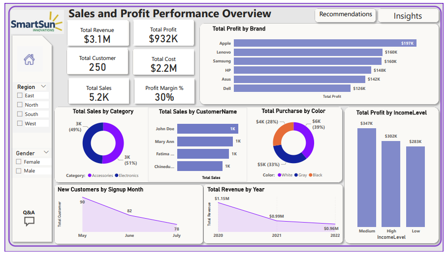
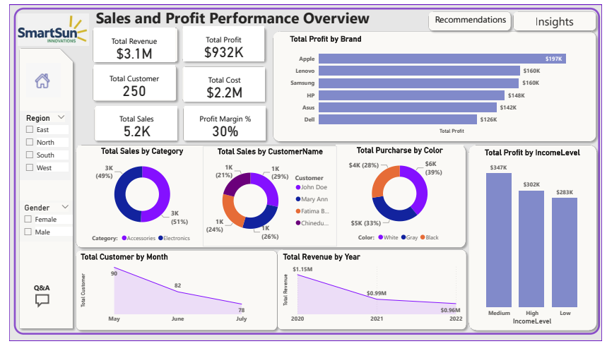
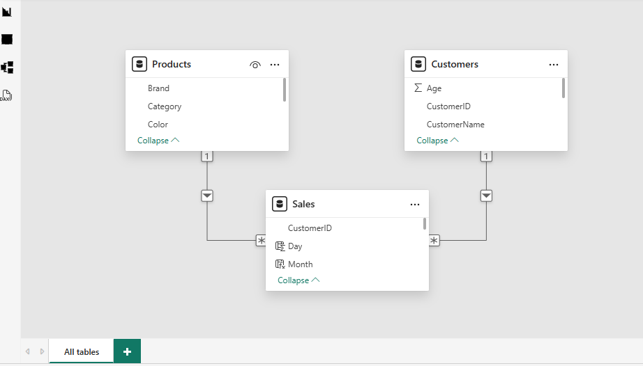

# Sales & Profit Performance Dashboard | Power BI Portfolio Case Study

An interactive sales analytics case study focused on turning transaction, product, and customer data into a business-facing performance overview. The dashboard screenshot highlights revenue, cost, profit, margin, category mix, customer behavior, brand profitability, and income-level comparisons.

> **Repository contents:** This package includes the Excel workbook, dashboard screenshots, and the data-model schema image. It does **not** currently include an editable Power BI `.pbix` report file. Add the `.pbix` file if you have it and are allowed to share it.

## Dashboard Preview

### Sales and profit overview



### Alternate dashboard view



### Data model

The supplied schema shows `Sales` connected to `Products` and `Customers` through product and customer identifiers.



## Business Problem

Sales teams and business leaders need a concise way to understand what is driving revenue and profit, which product brands perform well, and how customer segments differ. This project packages a Power BI dashboard case study around those questions and documents the data assumptions that should be checked before business decisions are made.

## Questions This Dashboard Is Designed to Explore

- What are the displayed revenue, cost, profit, and profit-margin KPIs?
- Which brands contribute the most profit in the current report view?
- How do product categories and colors compare by sales or purchase value?
- How does profit vary by customer income level?
- How do customer and revenue measures vary over time in the report?
- Can region and gender filters reveal useful differences between customer segments?

## Files Included

| File | Purpose |
|---|---|
| `Power BI Sales data.xlsx` | Source workbook containing Instructions, Products, Customers, Sales, and a hidden `cleanDATASET` sheet |
| `Sales_DASHBOARD.png` | Dashboard screenshot with customer-name and signup-month visuals |
| `DASHBOARD.png` | Alternate screenshot of the sales and profit overview |
| `Schema.png` | Screenshot of the Power BI relationship model |
| `README.md` | Project overview, methodology notes, and setup guidance |

## Data Model

The workbook contains three core business tables:

- **Sales** — sale ID, product ID, customer ID, quantity, sale date, sales amount, and unit cost.
- **Products** — product ID, product name, category, brand, color, and weight.
- **Customers** — customer ID, customer name, region, age, gender, income level, and signup date.

The intended model places `Sales` at the center, with product and customer attributes connected through their IDs. In Power BI, validate the data types, key uniqueness, and relationship cardinality before building measures.

## Analysis Workflow

1. **Inspect the source data.** Review each table, column meaning, missing values, duplicates, and date formats.
2. **Clean and standardize.** Normalize category labels and whitespace, verify numeric data types, and handle invalid or missing dates consistently.
3. **Model the tables.** Relate `Sales` to `Products` and `Customers` through their identifier columns.
4. **Define business measures.** Agree whether `SalesAmount` means a unit selling price or total transaction value before calculating revenue and profit.
5. **Build the report.** Use KPI cards, brand profitability comparisons, category breakdowns, customer segmentation, time-based visuals, and slicers for region and gender.
6. **Validate the output.** Reconcile the report totals against independently calculated totals from the cleaned data before making recommendations.

## Measures to Define or Validate in Power BI

The following DAX measures illustrate one possible calculation approach **if `SalesAmount` is the unit selling price** and `Quantity` is the number of units sold. Confirm the business definition and align the column names with your Power BI model before using them.

```DAX
Total Revenue =
SUMX(Sales, Sales[Quantity] * Sales[SalesAmount])

Total Cost =
SUMX(Sales, Sales[Quantity] * Sales[Unit Cost])

Total Profit =
[Total Revenue] - [Total Cost]

Profit Margin % =
DIVIDE([Total Profit], [Total Revenue])

Total Sales =
COUNTROWS(Sales)

Total Customers =
DISTINCTCOUNT(Customers[CustomerID])
```

If `SalesAmount` already stores transaction-level revenue, multiplying it by `Quantity` would overstate revenue. Confirm this point before publishing final KPIs.

## Dashboard Elements

- KPI cards for revenue, cost, profit, customer count, sales count, and profit margin.
- Brand-level profit comparison.
- Sales breakdown by product category and customer name.
- Purchase value by color.
- Profit by income level.
- Customer signup or customer-count trend and revenue by year.
- Region and gender slicers.
- Insight and recommendation panels shown in the supplied screenshots.

## Data Quality and Interpretation Notes

The included screenshot is a visual snapshot, not a validated output from an editable report in this repository. In particular, the screenshot's revenue-by-year visual displays **2020–2022**, while the visible raw `Sales` workbook rows include **2023** dates. The package does not include the `.pbix` file needed to inspect its filters, relationships, and measures. Reconcile these differences before interpreting time trends or presenting the displayed KPI values as independently verified results.

The dashboard screenshots display approximately **$3.1M revenue**, **$2.2M cost**, **$932K profit**, **30% profit margin**, **250 customers**, and **5.2K sales**. These are values visible in the provided screenshot and should be rechecked against the final model; they are not independently certified by this README.

## How to Recreate or Review the Project

1. Download or clone this repository.
2. Open `Power BI Sales data.xlsx` and inspect the `Sales`, `Products`, and `Customers` sheets. The `cleanDATASET` sheet is hidden in the supplied workbook.
3. Open Power BI Desktop and import the required tables from Excel.
4. Set appropriate data types, create and validate relationships, and confirm the meaning of `SalesAmount` and `Unit Cost`.
5. Add the measures above only after checking the assumptions and table/column names.
6. Rebuild the visuals, compare your results against the screenshots, and document any differences.
7. Save the completed report as a `.pbix` file and add it to the repository if sharing is permitted.

## Skills Demonstrated

- Power BI dashboard design and KPI communication
- Data modelling and relationship validation
- DAX measure design
- Data-quality review and assumption tracking
- Customer and product segmentation
- Business-focused data storytelling

## Suggested Next Improvements

- Include the editable `.pbix` report, if available and shareable.
- Add a data dictionary documenting column definitions and units.
- Record data-cleaning rules and before/after validation checks.
- Add a reconciliation table showing how each displayed KPI is calculated.
- Replace the sample dashboard snapshot with a final screenshot exported from the validated report.
- Add a concise findings report supported by verified numbers.

## Attribution and Reuse

The supplied project package's previous README credited **Lilian Arnold-Addo** and referenced the repository [Its-Lilianne/Power-Bi-Sales-Performance-Dashboard](https://github.com/Its-Lilianne/Power-Bi-Sales-Performance-Dashboard). If the dashboard design, workbook, or screenshots are reused from that work, retain appropriate credit and check the original repository's license and reuse conditions before republishing. This README is newly written documentation for the supplied package; it does not, by itself, establish authorship of the underlying dashboard or data.

## Maintainer

**Mayank Kumar**  
Analytics portfolio — Power BI · SQL · Excel · Business Analysis

---

*Portfolio note: A useful dashboard should make its assumptions visible, its metrics reproducible, and its recommendations traceable to verified data.*
